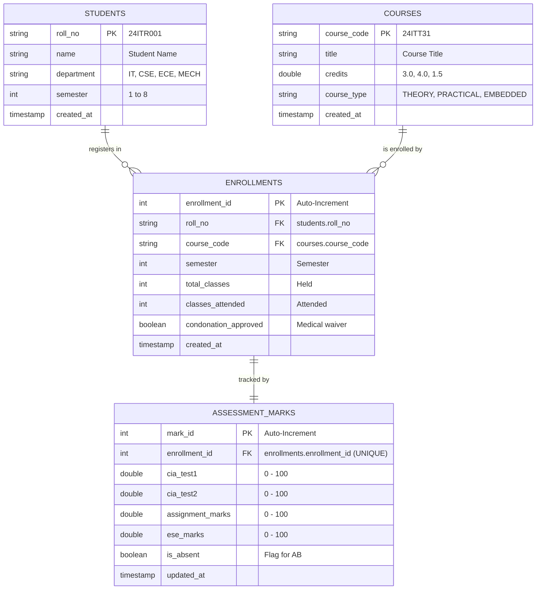

# Kongu Engineering College (Autonomous) - Regulation 2024 (R2024)
## Student Academic & Continuous Evaluation System using Java JDBC

---

### Institutional Information
* **Institution:** Kongu Engineering College (Autonomous), Perundurai, Erode - 638060, Tamil Nadu
* **Regulation:** Regulation 2024 (R2024) - Choice Based Credit System (CBCS)
* **Technology Stack:** Java 26 / SE 17+, JDBC (Java Database Connectivity), MySQL / MariaDB, SQLite (Embedded)

---

## 1. Executive Summary & Objective

The **KEC R2024 Student Academic & Continuous Evaluation System** is a database-driven enterprise academic management solution implemented in Java using JDBC. The system models the academic life cycle of engineering students under Regulation 2024, featuring:
1. **Student & Course Management:** Registration of student cohorts across engineering departments and cataloging Theory, Practical, and Embedded courses with assigned credit values.
2. **Course Enrollment & Continuous Attendance Tracking:** Recording semester course enrollments and tracking classes held vs. classes attended to enforce the R2024 attendance gating policy.
3. **Incremental Marks Entry ("Then and Now"):** Phased entry model matching real semester milestones:
   - **Phase 1 (Mid-Semester):** CIA Test 1 (0–100) and CIA Test 2 (0–100).
   - **Phase 2 (End of Semester):** Continuous Assessments, Quizzes, and Lab Evaluations (0–100).
   - **Phase 3 (Post Semester):** End Semester Examination (ESE) Marks (0–100) or Absence (AB).
4. **Autonomous Evaluation & Weightage Engine (R2024):** Strict implementation of differentiated assessment models for **THEORY (40:60)**, **PRACTICAL (60:40)**, and **EMBEDDED (50:50)** courses, including mandatory external minimum thresholds and 50% overall passing mark.
5. **Attendance Eligibility & Condonation Workflow:** Automatic assignment of **SA (Shortage of Attendance)** grade for students below 65%, with medical condonation verification for the 65%–74.9% band.
6. **Academic Performance Reporting:** Generation of official Student Semester Mark Sheets with **SGPA (Semester Grade Point Average)** and **Equivalent Percentage**, Attendance Defaulter Audit reports, and Department-wise Class Performance Summaries.

---

## 2. Directory & Package Structure

```
kec-evaluation-system/
│
├── bin/                                  # Compiled .class binaries
├── lib/                                  # JDBC Drivers & Logging dependencies
│   ├── mysql-connector-j-8.3.0.jar       # MySQL / MariaDB JDBC Driver
│   ├── sqlite-jdbc-3.45.1.0.jar          # SQLite Embedded JDBC Driver
│   ├── slf4j-api-2.0.12.jar              # Logging API
│   └── slf4j-simple-2.0.12.jar           # Simple Logger
│
├── src/
│   └── kec/
│       ├── model/                        # Domain Models & Value Objects
│       │   ├── Student.java              # Student entity (Roll No, Name, Dept, Sem)
│       │   ├── Course.java               # Course entity (Code, Title, Credits, Type)
│       │   ├── CourseType.java           # THEORY, PRACTICAL, EMBEDDED enum
│       │   ├── Enrollment.java           # Course registration & attendance
│       │   ├── AssessmentMarks.java      # Incremental marks entity
│       │   ├── CourseEvaluationResult.java # Detailed course breakdown & grade
│       │   ├── StudentSemesterReport.java # Aggregated semester grade report
│       │   └── ClassPerformanceSummary.java # Class statistics entity
│       │
│       ├── db/
│       │   └── DBConnection.java         # Dual-mode JDBC Manager (SQLite / MySQL)
│       │
│       ├── dao/
│       │   ├── StudentDAO.java           # CRUD operations for Students & Courses
│       │   └── AcademicDAO.java          # Enrollments, Attendance & Marks CRUD
│       │
│       ├── engine/
│       │   └── EvaluationEngine.java     # Pure KEC R2024 Academic Rule Engine
│       │
│       └── app/
│           ├── MainApp.java              # Interactive Menu-Driven Application
│           ├── DemoRunner.java           # Automated Verification & Test Suite
│           └── ReportPrinter.java        # Institutional ASCII report generator
│
├── kec_schema.sql                        # Production MySQL / MariaDB DDL script
├── compile_and_run.bat                   # Windows CMD Build & Launch Script
├── compile_and_run.ps1                   # Windows PowerShell Build & Launch Script
└── README.md                             # Comprehensive System Documentation
```

---

## 3. Database Schema & Architecture (`kec_schema.sql`)

The database architecture consists of four normalized tables linked through cascading foreign key constraints:



### Table Specifications:
1. **`students`**: Stores basic identity records. Primary key: `roll_no`.
2. **`courses`**: Course catalog with course codes, credits, and delivery format (`THEORY`, `PRACTICAL`, `EMBEDDED`).
3. **`enrollments`**: Associates a student to a course for a semester. Tracks `total_classes`, `classes_attended`, and `condonation_approved`. Unique constraint on `(roll_no, course_code, semester)`.
4. **`assessment_marks`**: Stores incremental marks across the three phases. Foreign key to `enrollments(enrollment_id)` with `UNIQUE` constraint ensuring 1:1 relationship.

---

## 4. Kongu Engineering College (R2024) Evaluation Rules

### 4.1 Attendance Eligibility Filter
$$\text{Attendance Percentage} = \left( \frac{\text{Classes Attended}}{\text{Total Classes Held}} \right) \times 100$$

* $\mathbf{\ge 75\%}$: **Eligible for ESE.** Direct permission to appear for End Semester Examinations.
* $\mathbf{65\% \text{ to } 74.9\%}$: **Conditionally Eligible.** Permitted to appear for ESE **only** if medical condonation is formally approved (`condonation_approved = true`). If not approved, student is barred and awarded **SA**.
* $\mathbf{< 65\%}$: **Barred from ESE (Shortage of Attendance).** Automatically awarded **SA** grade (0 Grade Points). Student is not allowed to register or take ESE.

---

### 4.2 Incremental Assessment Phases ("Then and Now")
* **Phase 1 (Mid-Semester):** Record CIA Test 1 ($0 \le \text{CIA}_1 \le 100$) and CIA Test 2 ($0 \le \text{CIA}_2 \le 100$).  
  $$\text{Tests Average} = \frac{\text{CIA}_1 + \text{CIA}_2}{2}$$
* **Phase 2 (End of Semester):** Record Continuous Assessment / Quizzes / Lab Evaluations ($0 \le \text{Assignment} \le 100$).  
  Combined Continuous Internal Assessment (on a 0–100 scale):
  - **THEORY:** $\text{CIA Total} = (\text{Tests Average} \times 0.60) + (\text{Assignment} \times 0.40)$
  - **PRACTICAL:** $\text{CIA Total} = (\text{Tests Average} \times 0.40) + (\text{Assignment} \times 0.60)$
  - **EMBEDDED:** $\text{CIA Total} = (\text{Tests Average} \times 0.50) + (\text{Assignment} \times 0.50)$
* **Phase 3 (Post Semester):** Record End Semester Examination ($0 \le \text{ESE Raw} \le 100$) or set `is_absent = true` (AB).

---

### 4.3 Course Type Evaluation Models & Passing Thresholds

| Course Type | CIA Weightage | ESE Weightage | Scaled ESE Minimum Threshold | Raw ESE Minimum Equivalent | Overall Pass Minimum |
| :--- | :---: | :---: | :---: | :---: | :---: |
| **THEORY** | **40%** | **60%** | **27.0 / 60.0** (45%) | 45.0 / 100.0 | **50.0 / 100.0** |
| **PRACTICAL** | **60%** | **40%** | **20.0 / 40.0** (50%) | 50.0 / 100.0 | **50.0 / 100.0** |
| **EMBEDDED** | **50%** | **50%** | **22.5 / 50.0** (45%) | 45.0 / 100.0 | **50.0 / 100.0** |

$$\text{Scaled CIA} = \text{CIA Total}_{100} \times W_{\text{CIA}}$$
$$\text{Scaled ESE} = \text{ESE Raw}_{100} \times W_{\text{ESE}}$$
$$\text{Total Course Mark} = \text{Scaled CIA} + \text{Scaled ESE}$$

#### Passing Rule:
A student passes a course if and only if **both** of the following conditions are satisfied:
1. $\text{Scaled ESE} \ge \text{ESE Minimum Threshold}$
2. $\text{Total Course Mark} \ge 50.0$

If either condition fails, the student is awarded **RA (Re-Appearance)** with 0 Grade Points.

---

### 4.4 10-Point Grading System

| Letter Grade | Description | Marks Range | Grade Point (GP) | Status |
| :---: | :--- | :---: | :---: | :---: |
| **O** | Outstanding | 91 – 100 | **10** | PASS |
| **A+** | Excellent | 81 – 90 | **9** | PASS |
| **A** | Very Good | 71 – 80 | **8** | PASS |
| **B+** | Good | 61 – 70 | **7** | PASS |
| **B** | Average | 50 – 60 | **6** | PASS |
| **RA** | Re-Appearance (Failed aggregate or ESE minimum) | < 50 | **0** | FAIL |
| **SA** | Shortage of Attendance (< 65% or unapproved condonation) | — | **0** | BARRED |
| **AB** | Absent in End Semester Examination | — | **0** | ABSENT |

---

### 4.5 SGPA and Equivalent Percentage Formulas

$$\text{SGPA} = \frac{\sum_{i=1}^{n} \left( \text{Course Credits}_i \times \text{Grade Points Earned}_i \right)}{\sum_{i=1}^{n} \text{Course Credits}_i}$$

$$\text{Equivalent Percentage} = \text{SGPA} \times 10$$

---

## 5. Build & Execution Instructions

### Prerequisites:
- Java JDK 17 or higher (Java 26 supported).
- Both SQLite JDBC and MySQL Connector/J JAR files are pre-packaged in the `lib/` folder.

### Running via Scripts:
- **Windows Command Prompt:**
  ```cmd
  compile_and_run.bat
  ```
- **PowerShell:**
  ```powershell
  .\compile_and_run.ps1
  ```

### Manual Compilation & Execution:
1. **Compile all sources:**
   ```powershell
   javac -d bin -cp "lib/*" (Get-ChildItem -Path "src" -Filter "*.java" -Recurse).FullName
   ```
2. **Run Interactive Menu Application (`MainApp`):**
   ```powershell
   java -cp "bin;lib/*" kec.app.MainApp
   ```
3. **Run Automated Verification Suite (`DemoRunner`):**
   ```powershell
   java -cp "bin;lib/*" kec.app.DemoRunner
   ```

---

## 6. Execution Proofs & Verification Outputs

The system was verified against all specifications through both the interactive menu and the automated verification suite.

### Proof 1: Student and Course Registration (Data Entry)
```
[STEP 2] DEMONSTRATING STUDENT & COURSE REGISTRATION (SPECIFICATION 1)
------------------------------------------------------------------------------------------------------------------------
>> Added New Student : [24ITR009] Praveen Kumar S      | Dept: IT     | Sem: 3
>> Added New Course  : [24ITT41] Design and Analysis of Algorithms   | Credits: 4.0 | Type: THEORY   
```

### Proof 2: Incremental Marks Entry ("Then and Now")
```
[STEP 4] INCREMENTAL / PHASED MARKS ENTRY ('THEN AND NOW') (SPECIFICATION 2)
------------------------------------------------------------------------------------------------------------------------
--- Phase 1: Mid-Semester CIA (CIA Test 1 and CIA Test 2) ---
   [THEN] Current Marks : Marks [CIA1: N/A, CIA2: N/A, Assign: N/A, ESE: N/A, Absent: false]
   [NOW]  Recorded Phase 1 : CIA1 = 88.0, CIA2 = 92.0 | Tests Average = 90.0

--- Phase 2: End of Semester CIA (Assignments / Quizzes / Lab Evaluations) ---
   [THEN] Current Marks : Marks [CIA1: 88.0, CIA2: 92.0, Assign: N/A, ESE: N/A, Absent: false]
   [NOW]  Recorded Phase 2 : Assignment = 95.0
   >> Combined Internal (0-100 scale) : 92.00 | Scaled Internal (THEORY 40%) : 36.80 / 40.0

--- Phase 3: Post-Semester (End Semester Examination - ESE Marks Entry) ---
   [THEN] Current Marks : Marks [CIA1: 88.0, CIA2: 92.0, Assign: 95.0, ESE: N/A, Absent: false]
   [NOW]  Recorded Phase 3 : ESE Raw = 85.0 / 100.0
   >> Scaled ESE (THEORY 60%)        : 51.00 / 60.0 (Min Req: 27.0)
   >> Total Subject Mark (100)       : 87.80 | Grade: A+ (Grade Point: 9)
   >> Status: PASS | Remarks: Successfully cleared course.
```

### Proof 3: Attendance Gating and Condonation Workflow
```
[STEP 6] ATTENDANCE ELIGIBILITY & CONDONATION ENFORCEMENT (SPECIFICATION 4)
------------------------------------------------------------------------------------------------------------------------
 Case A: Attendance < 65% (Student 24ITR003 in 24ITT31: 32/60 = 53.3%)
   Att: 53.3% -> Eligible for ESE? false -> Result: BARRED, Awarded 'SA' Grade Point: 0
 Case B: Attendance 65-74.9% WITHOUT Condonation (Student 24ITR003 in 24ITP31: 20/30 = 66.7%)
   Att: 66.7% | Condonation: false -> Eligible? false -> Result: Awarded 'SA' Grade Point: 0
 Case C: Attendance 65-74.9% WITH Condonation Approved (Student 24ITR002 in 24ITP31: 21/30 = 70.0%)
   Att: 70.0% | Condonation: true -> Eligible? true -> Permitted to take ESE -> Cleared with A+ Grade!
```

### Proof 4: Student Semester Mark Sheet (High Performer `24ITR001` - SGPA 9.68)
```
======================================================================================================================================
                                        KONGU ENGINEERING COLLEGE (AUTONOMOUS)
                                        PERUNDURAI, ERODE - 638060, TAMIL NADU
                                      OFFICE OF THE CONTROLLER OF EXAMINATIONS
                                 STUDENT SEMESTER GRADE REPORT - REGULATION 2024 (R2024)
======================================================================================================================================
 Roll Number : 24ITR001        | Name       : Aadhavan K                    
 Department  : IT              | Semester   : 3                             
--------------------------------------------------------------------------------------------------------------------------------------
Course    | Course Title                 | Type      | Cred | Att %  | CIA 1 | CIA 2 | Assign | CIA Tot | ESE Rw | ESE Sc | Total | Grade | GP | Result      
--------------------------------------------------------------------------------------------------------------------------------------
24ITE31   | Object Oriented Programmi... | EMBEDDED  |  4.0 |  94.7% |  88.0 |  90.0 |  92.0 |  45.25 |   86.0 |  43.00 |  88.3 | A+    |  9 | PASS        
24ITP31   | Data Structures Laboratory   | PRACTICAL |  1.5 |  96.7% |  95.0 |  92.0 |  98.0 |  57.72 |   94.0 |  37.60 |  95.3 | O     | 10 | PASS        
24ITT31   | Data Structures and Algor... | THEORY    |  3.0 |  93.3% |  92.0 |  94.0 |  96.0 |  37.68 |   90.0 |  54.00 |  91.7 | O     | 10 | PASS        
24MAT31   | Discrete Mathematics and ... | THEORY    |  4.0 |  95.0% |  90.0 |  88.0 |  95.0 |  36.56 |   92.0 |  55.20 |  91.8 | O     | 10 | PASS        
--------------------------------------------------------------------------------------------------------------------------------------
 Total Registered Credits : 12.5   | Total Earned Credits : 12.5   | Total Grade Points Earned : 121.00
 SGPA                     : 9.68   | Equivalent Percentage: 96.80 % | Overall Semester Result   : PASS (ALL COURSES CLEARED)
======================================================================================================================================
```

### Proof 5: Student Semester Mark Sheet with SA Attendance Shortages (`24ITR003`)
```
======================================================================================================================================
 Roll Number : 24ITR003        | Name       : Chandru M                     
 Department  : IT              | Semester   : 3                             
--------------------------------------------------------------------------------------------------------------------------------------
Course    | Course Title                 | Type      | Cred | Att %  | CIA 1 | CIA 2 | Assign | CIA Tot | ESE Rw | ESE Sc | Total | Grade | GP | Result      
--------------------------------------------------------------------------------------------------------------------------------------
24ITE31   | Object Oriented Programmi... | EMBEDDED  |  4.0 |  80.0% |  62.0 |  58.0 |  65.0 |  31.25 |   54.0 |  27.00 |  58.3 | B     |  6 | PASS        
24ITP31   | Data Structures Laboratory   | PRACTICAL |  1.5 |  66.7% |  65.0 |  70.0 |  75.0 |  43.20 |    SA  |    SA  |  --  | SA    |  0 | BARRED (SA) 
24ITT31   | Data Structures and Algor... | THEORY    |  3.0 |  53.3% |  60.0 |  65.0 |  70.0 |  26.20 |    SA  |    SA  |  --  | SA    |  0 | BARRED (SA) 
24MAT31   | Discrete Mathematics and ... | THEORY    |  4.0 |  76.7% |  70.0 |  68.0 |  72.0 |  28.08 |   64.0 |  38.40 |  66.5 | B+    |  7 | PASS        
--------------------------------------------------------------------------------------------------------------------------------------
 Total Registered Credits : 12.5   | Total Earned Credits : 8.0    | Total Grade Points Earned : 52.00 
 SGPA                     : 4.16   | Equivalent Percentage: 41.60 % | Overall Semester Result   : FAIL (SHORTAGE OF ATTENDANCE)
======================================================================================================================================
```

### Proof 6: Attendance Defaulter Audit Report
```
========================================================================================================================
                                      KONGU ENGINEERING COLLEGE (AUTONOMOUS)
                                  CONTINUOUS EVALUATION & ATTENDANCE DEFAULTER AUDIT
                                  Filter: Semester: 3 | Department: IT
========================================================================================================================
Roll No    | Student Name         | Course   | Course Title              | Held   | Attended | Att %   | Condonation  | Barred / Action
------------------------------------------------------------------------------------------------------------------------
24ITR003   | Chandru M            | 24ITP31  | Data Structures Labora... | 30     | 20       |  66.7% | REQUIRED     | SA (No Condonation)
24ITR003   | Chandru M            | 24ITT31  | Data Structures and Al... | 60     | 32       |  53.3% | NOT ELIGIBLE | SA (Barred <65%)
========================================================================================================================
 Policy Notice: As per KEC R2024, students with Attendance < 65% are strictly barred and awarded 'SA'.
                 Students with Attendance 65% - 74.9% require formal Medical Condonation approval to appear for ESE.
========================================================================================================================
```

### Proof 7: Class Performance & Result Summary
```
=========================================================================================
                              KONGU ENGINEERING COLLEGE (AUTONOMOUS)
                       CLASS ACADEMIC PERFORMANCE & RESULT SUMMARY (R2024)
=========================================================================================
 Department              : IT                   | Semester : 3
 Total Students Evaluated: 6                    | Total Course Appearances: 21
 Total Passed Courses    : 17                   | Total Re-Appearances(RA): 1
 Shortage of Att. (SA)   : 2                    | Absentees (AB)          : 1
-----------------------------------------------------------------------------------------
 OVERALL PASS PERCENTAGE :  80.95%
 CLASS AVERAGE SGPA      :   6.54  (Equivalent Class Percentage: 65.40%)
-----------------------------------------------------------------------------------------
 Letter Grade Distribution:
   [O ] Outstanding (91-100) :   4
   [A+] Excellent   (81-90)  :   5
   [A ] Very Good   (71-80)  :   3
   [B+] Good        (61-70)  :   4
   [B ] Average     (50-60)  :   1
   [RA] Re-Appear   (<50/Min):   1
   [SA] Shortage of Attend.  :   2
   [AB] Absent in ESE        :   1
=========================================================================================
```

---

## 7. Submission Checklist Verification

- [x] **Database Schema Script (`kec_schema.sql`):** Fully defined with constraints, foreign keys, and seed data.
- [x] **JDBC Connection Management (`DBConnection.java`):** Dual-mode supporting both embedded SQLite and MySQL/MariaDB.
- [x] **CRUD Operations & Logic (`StudentDAO.java`, `AcademicDAO.java`, `EvaluationEngine.java`):** Enforces incremental marks and R2024 rules.
- [x] **Menu-Driven Application (`MainApp.java`):** Interactive console UI covering all options.
- [x] **Automated Verification Suite (`DemoRunner.java`):** Non-interactive test driver generating live verification proofs.
- [x] **Execution Documentation:** Detailed logs, calculations, and ASCII outputs documented above.
